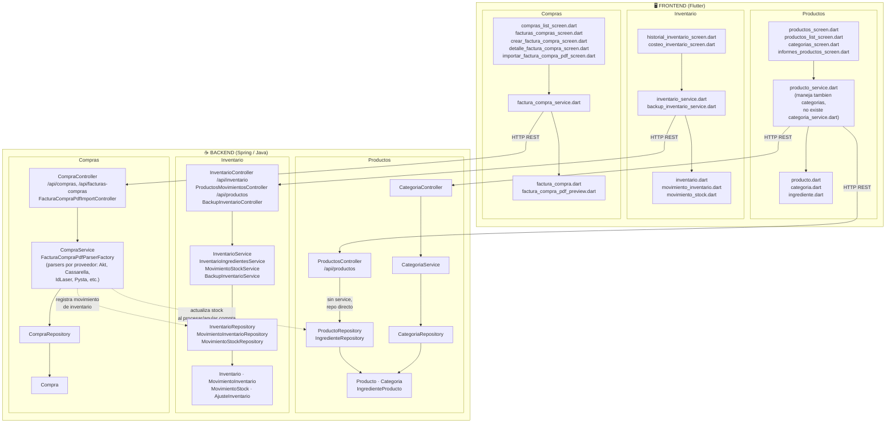

# Diagrama: Productos, Inventario y Compras — Frontend + Backend

**Fecha:** 2026-11-03

Diagrama de capas (modelos, services, controllers, repositorios) para los dominios
Productos, Inventario y Compras, cubriendo tanto el frontend (Flutter, este repo)
como el backend (Spring/Java, repo `vercy/src`). Construido verificando los
archivos y dependencias reales de ambos repos, no es una estructura genérica.

## Notas verificadas en el código (no es un diagrama inventado)

- **Backend asimétrico**: `ProductosController` NO tiene `ProductoService` — va
  directo al `ProductoRepository` (extiende `BaseController<Producto, String>`).
  `Categoria`, en cambio, sí tiene su stack completo Controller→Service→Repository.
  Es inconsistencia real del backend, no una simplificación del diagrama.
- **Frontend sin capa de repositorio/controller**: como se señala en
  [`componentes_compartidos_y_duplicacion.md`](componentes_compartidos_y_duplicacion.md),
  el frontend no tiene repository ni controller — las screens llaman servicios
  directo, y la mayoría de servicios tampoco pasan por `BaseApiService`.
- **El acoplamiento real "Compras → Inventario/Productos"**: `CompraService`
  inyecta `ProductoRepository`, `InventarioRepository`,
  `MovimientoInventarioRepository` y `MovimientoStockService` directamente —
  confirma que el backend revierte/aplica stock al procesar o anular una compra;
  el frontend solo consulta el historial de movimientos.
- **Categorías en el frontend** no tienen servicio propio: `categorias_screen.dart`
  usa `producto_service.dart`, aunque el backend sí las separa en su propio
  Controller/Service/Repository.

*Generado a partir de los archivos reales en `lib/` (este repo) y
`vercy/src/main/java/com/prog3/security/` (backend), no de una plantilla genérica.
Volver a verificar con grep si ha pasado tiempo desde esta fecha.*
